# Lynia — Architecture

Motorbike delivery for Zimbabwe. Two order types share one fleet, one API and one data model:

- **Parcels (Send)** run on an inDrive-style **offer loop**: the customer names a price, every online
  rider in the country can accept or counter, the customer picks one, and the trip runs through a
  code-gated delivery lifecycle with live tracking.
- **Merchant orders** (restaurants, shops, pharmacy) run on a **kitchen lifecycle** at the venue, then a
  first-accept-wins **dispatch** to nearby riders, then the same delivery states. Cash on delivery.

This document is the engineering map of the system: how the pieces fit, where the data lives,
how the hard flows work, and how it deploys. It complements the product doc
([CONCEPT](CONCEPT.md)) and the ops runbook ([AZURE-OWNER-RUNBOOK](AZURE-OWNER-RUNBOOK.md)) —
those cover *why* and *how to operate*; this covers *how it is wired*. User-facing copy says "biker";
code says `rider`, and so does this doc.

> Diagrams are [Mermaid](https://mermaid.js.org/). GitHub renders them inline; in an editor use a
> Mermaid preview extension.

---

## Table of contents

- **[Master architecture diagram](#master-architecture-diagram)** — everything on one canvas
1. [System context](#1-system-context)
2. [Monorepo layout](#2-monorepo-layout)
3. [Deployment topology (Azure)](#3-deployment-topology-azure)
4. [API module map (NestJS)](#4-api-module-map-nestjs)
5. [Data model (ERD)](#5-data-model-erd)
6. [The offer loop (core sequence)](#6-the-offer-loop-core-sequence)
7. [Order lifecycle state machine](#7-order-lifecycle-state-machine) (incl. merchant orders)
8. [Authentication (OTP + JWT sessions)](#8-authentication-otp--jwt-sessions)
9. [Rider onboarding & KYC](#9-rider-onboarding--kyc)
10. [Live tracking (WebSocket)](#10-live-tracking-websocket)
11. [Media uploads (signed URLs)](#11-media-uploads-signed-urls)
12. [The cloud-portable adapter seam](#12-the-cloud-portable-adapter-seam)
13. [Concurrency-safety model](#13-concurrency-safety-model)
14. [Background jobs & self-healing](#14-background-jobs--self-healing)
15. [CI / CD pipeline](#15-ci--cd-pipeline)
16. [REST + WebSocket surface](#16-rest--websocket-surface)

---

## Master architecture diagram

One canvas: clients, the API's edge, feature lanes, adapter seam and background workers, every data
store (with the load-bearing constraints called out), the external vendors, and the labelled data
flows between them. Solid arrows are primary request/data paths; dotted arrows are best-effort or
out-of-band paths.

The sections below zoom into each region ([deployment](#3-deployment-topology-azure),
[modules](#4-api-module-map-nestjs), [data model](#5-data-model-erd),
[concurrency](#13-concurrency-safety-model)).

```mermaid
flowchart TB
    %% ===================== Clients =====================
    subgraph CLIENTS["Clients"]
        direction LR
        CUST["📱 Customer app<br/>Expo / RN (+ web export)"]
        RIDER["🏍️ Rider app<br/>Expo / RN"]
        MERCH["🏪 Merchant web app<br/>Next.js static"]
        ADMIN["🖥️ Admin console<br/>Next.js"]
    end

    %% ===================== External vendors =====================
    subgraph EXT["External integrations (behind adapters)"]
        direction LR
        OTPV["WhatsApp Cloud API / Bird /<br/>local SMS — OTP send"]
        FCM["FCM + APNs<br/>push"]
        DIDIT["Didit<br/>ID / KYC"]
    end

    %% ===================== API =====================
    subgraph API["@lynia/api · NestJS on Azure Container Apps"]
        direction TB
        subgraph EDGE["Edge"]
            direction LR
            REST["REST controllers<br/>JWT / admin / merchant guards"]
            GW["Socket.IO<br/>TrackingGateway"]
        end
        subgraph FEAT["Feature lanes"]
            direction LR
            AUTH["Auth<br/>OTP · JWT · sessions"]
            OFF["Offers<br/>make · list"]
            MATCH["Matching<br/>select offer · expiry"]
            LIFE["Lifecycle<br/>advance · deliver · rate · cancel"]
            MER["Merchant<br/>menu · kitchen · dispatch · cash"]
            RID["Riders<br/>onboard · online"]
            KYCM["KYC<br/>webhook · reconcile"]
            WAL["Wallet<br/>prepaid commission"]
            TRK["Tracking<br/>geo · access checks"]
            NOTIF["Notifications<br/>push · feed"]
            UP["Uploads<br/>SAS URLs"]
            ADM["Admin API"]
        end
        subgraph SEAM["Cloud adapter seam (D7)"]
            direction LR
            STO["StorageAdapter"]
            PSH["PushAdapter"]
            PAY["PaymentRail (stub)"]
        end
        subgraph JOBS["Background workers (BullMQ + reconcilers)"]
            direction LR
            QEXP["offer-expiry"]
            QAC["rating auto-close"]
            RECON["DB reconcilers<br/>lifecycle · merchant · dispatch"]
        end
    end

    %% ===================== Data stores =====================
    subgraph STORE["Data stores"]
        direction TB
        subgraph PG["PostgreSQL 16 + PostGIS"]
            direction LR
            TORD["orders<br/>🔒 one_active_ride<br/>🔒 otp_hash (hashed)"]
            TOFF["offers<br/>🔒 unique(order,rider)"]
            TRID["riders<br/>geog · GiST index"]
            TPRO["profiles · sessions<br/>device_tokens"]
            TWAL["commission ledger<br/>🔒 one debit per order"]
            TMER["merchants · dishes<br/>order items · prescriptions"]
        end
        REDIS[("Azure Managed Redis<br/>OTP + rate-limit ·<br/>BullMQ · WS pub/sub · geo index")]
        BLOB[["Blob Storage<br/>lynia-media"]]
    end

    %% ---------- Clients → API ----------
    CUST -->|"REST: create order · select offer · rate · place merchant order"| REST
    RIDER -->|"REST: make offer · advance · deliver code · accept dispatch"| REST
    MERCH -->|"REST: menu · accept · ready · book a rider"| REST
    ADMIN -->|"admin JWT"| REST
    CUST <-->|"WS: order:status · position · offers:changed"| GW
    RIDER <-->|"WS: rider:location · board:subscribe → board:new-order"| GW
    MERCH <-->|"WS: merchant queue"| GW

    %% ---------- Clients → storage (direct upload) ----------
    CUST -.->|"PUT bytes (SAS URL)"| BLOB
    RIDER -.->|"PUT bytes (SAS URL)"| BLOB
    MERCH -.->|"PUT bytes (SAS URL)"| BLOB

    %% ---------- Edge → lanes ----------
    REST --> AUTH & OFF & MATCH & LIFE & MER & RID & KYCM & WAL & NOTIF & UP & ADM
    GW --> TRK

    %% ---------- Lanes → stores ----------
    AUTH -->|"sessions · hashed OTP/refresh"| TPRO
    AUTH -->|"OTP store · rate-limit counters"| REDIS
    OFF -->|"insert (one round)"| TOFF
    MATCH -->|"guarded CAS → assigned"| TORD
    MATCH -->|"schedule 90–100s expiry"| REDIS
    LIFE -->|"guarded CAS · row-lock code verify"| TORD
    LIFE -->|"commission debit (same tx)"| TWAL
    MER -->|"phase CAS · dispatch rounds"| TORD
    MER --> TMER
    RID --> TRID
    KYCM -->|"monotonic update (kycRef)"| TRID
    TRK -->|"nearest-first · update geog"| TRID
    WAL --> TWAL
    UP --> STO
    ADM -->|"reads · audited actions"| PG

    %% ---------- Background workers ----------
    REDIS --> QEXP -->|"expire (idempotent CAS)"| TORD
    REDIS --> QAC -->|"complete"| TORD
    RECON -->|"close stale · sweep windows"| TORD

    %% ---------- Realtime fan-out ----------
    LIFE -.->|"emitOrderStatus"| GW
    OFF -.->|"offers:changed (signal only)"| GW
    GW <-.->|"Socket.IO adapter fan-out"| REDIS

    %% ---------- Adapter seam → cloud/vendors ----------
    STO --> BLOB
    NOTIF --> PSH --> FCM
    AUTH -->|"send code"| OTPV
    OTPV -.->|"HMAC webhook → /webhooks/whatsapp"| REST
    RID -->|"create verification session"| DIDIT
    DIDIT -->|"HMAC webhook → /kyc/callback"| REST

    classDef ext fill:#fde68a,stroke:#b45309,color:#111;
    classDef store fill:#bbf7d0,stroke:#15803d,color:#111;
    classDef safe fill:#fee2e2,stroke:#b91c1c,color:#111,stroke-width:2px;
    classDef client fill:#bfdbfe,stroke:#1d4ed8,color:#111;
    class OTPV,FCM,DIDIT ext;
    class REDIS,BLOB,TPRO,TMER store;
    class TORD,TOFF,TRID,TWAL safe;
    class CUST,RIDER,MERCH,ADMIN client;
```

**How to read it:**

- **🔒 red boxes** are the tables whose database constraints make the money and assignment paths
  correct — `orders` (`one_active_ride` + the hashed handover code), `offers` (`unique(order, rider)`),
  `riders` (the `geog` GiST index) and the commission ledger (one debit per order). Full detail in
  [§13](#13-concurrency-safety-model).
- **Redis** wears four hats: OTP + rate-limit counters, BullMQ queues, Socket.IO pub/sub across API
  replicas, and the rider geo index.
- **Amber boxes** are external vendors, reached through adapters ([§12](#12-the-cloud-portable-adapter-seam)),
  except the Didit and WhatsApp webhooks, which post back in.
- Photo bytes never transit the API — clients PUT to Blob Storage with a short-lived SAS URL
  ([§11](#11-media-uploads-signed-urls)).

---

## 1. System context

Who talks to Lynia and across which channels. The mobile app is the customer and rider surface (the
same app is exported for the web at `app.lyniago.com` for iPhone users). The merchant app is a
phone-first web app. The admin console is an internal support tool. The API is an owned NestJS
service (no BaaS) that integrates with external providers behind adapters.

```mermaid
graph TB
    customer(["Customer<br/>(Android app / app.lyniago.com)"])
    rider(["Rider<br/>(Android app)"])
    merchant(["Merchant staff<br/>(merchant.lyniago.com)"])
    ops(["Ops / Support<br/>(admin.lyniago.com)"])

    subgraph lynia["Lynia platform"]
        api["<b>@lynia/api</b><br/>NestJS · REST + Socket.IO"]
        admin["<b>@lynia/admin</b><br/>Next.js console"]
        db[("PostgreSQL + PostGIS<br/>Prisma schema")]
        redis[("Redis<br/>OTP · rate-limit · BullMQ · WS pub/sub")]
        blob[["Blob Storage<br/>photos · prescriptions"]]
    end

    otp["WhatsApp / Bird / local SMS<br/>(OTP delivery)"]
    push["FCM + APNs<br/>(push)"]
    didit["Didit<br/>(ID / KYC verification)"]
    maps["Google Maps Platform<br/>(client-side maps, places)"]

    customer -->|"REST + WS"| api
    rider -->|"REST + WS"| api
    merchant -->|"REST + WS"| api
    ops --> admin
    admin -->|"admin token + operator identity"| api

    api --> db
    api --> redis
    api -->|"SAS URLs"| blob
    customer -.->|"direct upload"| blob
    rider -.->|"direct upload"| blob
    merchant -.->|"direct upload"| blob

    api <-->|"send OTP · delivery-status webhook"| otp
    api -->|"send push"| push
    api <-->|"create session · HMAC webhook"| didit
    customer -.-> maps
    merchant -.-> maps

    classDef ext fill:#fde68a,stroke:#b45309,color:#111;
    classDef core fill:#bfdbfe,stroke:#1d4ed8,color:#111;
    class otp,push,didit,maps ext;
    class api,admin core;
```

Design rule that shapes everything downstream: **the API owns its data and business logic; every
cloud-specific capability (storage, secrets, push, payments) is reached through an adapter
interface**, so the cloud is a `CLOUD_PROVIDER` switch rather than a rewrite
([§12](#12-the-cloud-portable-adapter-seam)). The move from GCP to Azure (2026-09) used exactly that
seam.

---

## 2. Monorepo layout

pnpm workspaces + Turborepo. `packages/shared` is the contract layer every app imports, which keeps the
wire shape from drifting between the API and its clients.

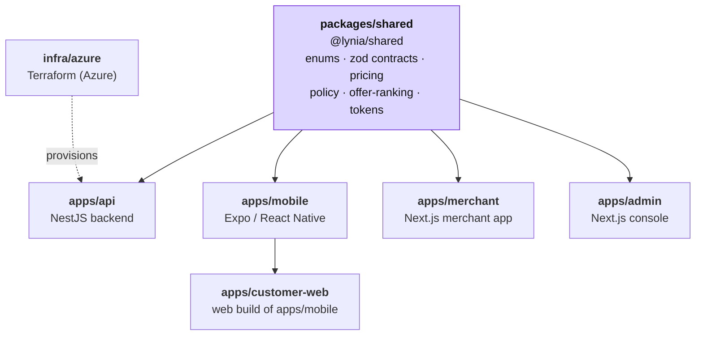

| Workspace | Stack | Role |
|---|---|---|
| `packages/shared` | TypeScript, zod | Domain enums, API contracts, pricing, policy constants (`policy.ts`), merchant-order money and timing (`restaurants-order.ts`), service area, offer ranking, design tokens. Built first. |
| `apps/api` | NestJS, Prisma, Socket.IO, BullMQ | The backend. |
| `apps/mobile` | Expo (React Native), expo-router, React Query | Customer + rider app (Android build). |
| `apps/customer-web` | Cloudflare Worker (assets only) | Finishes and serves the web export of `apps/mobile` at `app.lyniago.com`. |
| `apps/merchant` | Next.js static export | Merchant app at `merchant.lyniago.com`, served from Cloudflare Workers. |
| `apps/admin` | Next.js (App Router) | Internal support console at `admin.lyniago.com`. |
| `apps/website` | Static site | Marketing site `lyniago.com` (shipped as-is from its handoff; see `docs/WEBSITE.md`). |
| `infra/azure` | Terraform | Production and staging infrastructure. |
| `infra/terraform` | Terraform | The retired GCP stack (suspended 2026-09-17). Not deployed; kept only because some specs read it. |

Turborepo wires the task graph: `build`/`typecheck`/`test` all `dependsOn: ["^build"]`, so
`@lynia/shared` compiles before any app that imports it.

---

<a id="3-deployment-topology-gcp"></a>

## 3. Deployment topology (Azure)

Provisioned by Terraform in `infra/azure/` (region `southafricanorth`; one module, separate state per
environment). Owner steps are in `infra/azure/README.md` and [AZURE-OWNER-RUNBOOK](AZURE-OWNER-RUNBOOK.md).

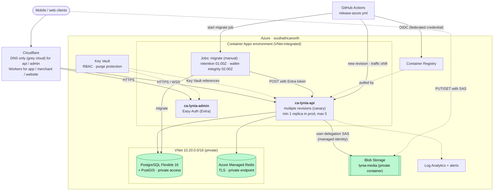

Key facts (all from `infra/azure/*.tf`):

- **Compute.** `ca-lynia-api` runs in **multiple revision mode** so a release can shift traffic
  10 → 50 → 100. External ingress, TLS only (`allow_insecure_connections = false`), `transport = auto`
  for WebSocket upgrades. Scale: min 1 replica in production (the in-process sweeps and BullMQ workers
  need one), max 5, an HTTP-concurrency rule at 150. `TRUST_PROXY=1` (one hop). Session affinity is
  off: Azure supports it only in single-revision mode (an open owner decision, `infra/azure/README.md`).
- **Data tier.** Postgres 16 Flexible Server, VNet-injected, **no public endpoint**, PITR 7 days,
  `sslmode=require`. Max 5 API replicas × a pool of 5 keeps under the B1ms connection ceiling.
  Azure Managed Redis, TLS only, public access disabled, reached through a private endpoint.
- **Secrets.** Key Vault (RBAC mode, purge protection) is created by `bootstrap.sh`, which also seeds the
  JWT, PII, token-hash and admin secrets so Terraform never holds them. Container apps reference secrets
  by versionless URI; each identity can read only its own secrets. The app still reads plain env vars
  (§12). Exceptions: the Postgres password and Redis key are written by Terraform (inside
  `DATABASE-URL` / `REDIS-URL`).
- **Storage.** One StorageV2 account, private container `lynia-media`. Shared keys are off; the API mints
  **user-delegation SAS** URLs with its managed identity. The public endpoint stays on because clients
  PUT/GET directly. CORS allows only the merchant and customer-web origins. Versioning on; 14-day soft
  delete. No lifecycle rule (see [DATA-RETENTION](DATA-RETENTION.md)).
- **Identities.** One user-assigned identity per runtime (`api`, `jobs`, `web`). The CI deploy identity
  per environment has scoped roles (Container Apps Contributor, Jobs Contributor, AcrPush, Monitoring
  Reader, …) and no Owner.
- **Scheduled work.** Container Apps jobs replace Cloud Scheduler: `caj-lynia-retention` (daily 01:00Z,
  `POST /admin/retention/purge`) and `caj-lynia-wallet-integrity` (daily 02:00Z,
  `POST /admin/wallet/integrity-check`). Each gets an Entra token for the scheduler audience;
  the API checks it with `SCHEDULER_AUTH=azure`.
- **Edge.** Cloudflare is **DNS-only** for `api.lyniago.com` and `admin.lyniago.com`; Container Apps
  issues the managed certificates. There is no WAF ([SECURITY](SECURITY.md) P0-3).
- **Web apps.** `app.lyniago.com` (customer web), `merchant.lyniago.com` and `lyniago.com` are static
  assets on Cloudflare Workers (`deploy-customer-web.yml`, `deploy-merchant-web.yml`,
  `deploy-website.yml`). Terraform still defines a `ca-lynia-merchant` container app; the public merchant
  host is served by the Worker.
- **Monitoring.** Log Analytics with a daily ingestion cap; alerts for failed or missed jobs, Postgres
  connections above 40, and a monthly budget.
- **Staging.** The Terraform supports a staging environment, but one subscription allows one Container
  Apps environment per region, so staging was destroyed in favour of production (`infra/azure/README.md`).

---

## 4. API module map (NestJS)

`ConfigModule` and `PrismaModule` are global infrastructure; the adapter modules form the cloud seam;
everything else is a feature lane. Arrows are the dependency direction (who injects whom). The full list
is `apps/api/src/app.module.ts`.

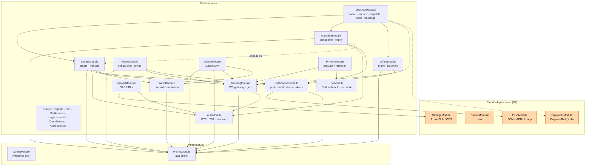

Notable cross-module wiring:

- **`OrderLifecycleService`** (in `OrdersModule`) injects the `TrackingGateway` so a committed status
  change fans out over WebSockets, plus `NotificationsService` for push — both best-effort. It calls the
  wallet's per-ride commission debit **inside the same completion transaction**, so the debit commits
  atomically with the order completing.
- **`OffersModule`** and **`MatchingModule`** are the two halves of the parcel offer loop; both write
  `orders`/`offers` under the same concurrency guards ([§13](#13-concurrency-safety-model)).
- **`MerchantModule`** depends on the Send modules, never the reverse: the `express-no-merchant-coupling`
  rule in `.dependency-cruiser.cjs` forbids Send code importing merchant code. Its main services:
  `FoodOrderService` (placement and the kitchen phases), `FoodDispatchService` (rider dispatch rounds,
  with a pluggable `DispatchStrategy`), `FoodDebtService` (the doorstep cash handshake and the
  collect-and-return ledger), `PrescriptionService`, and `MerchantBookingService` ("book a rider", which
  drives Send's own offer and select services as the business's account).
- **`AppBootstrapModule`** (`GET /app/bootstrap`) composes the profile and the role's active order into
  one round trip for the client's cold start.

Bootstrap (`main.ts`) initializes OpenTelemetry **before** the Nest app, enables `rawBody` (to
HMAC-verify the Didit webhook against the unparsed body), and enables shutdown hooks (so BullMQ workers
close cleanly).

---

## 5. Data model (ERD)

Prisma owns the schema and the typed client (`apps/api/prisma/schema.prisma`). The hot-path
constraints and the PostGIS geography column are driven by raw SQL in `migrations/0001_init` and later
migrations. `Order.items` (line-items JSON) is the superapp line-items seam, realised; `itemDesc` stays
as the derived summary.

The ERD below is deliberately scoped to the core parcel tables. The schema also holds:

- **Merchant verticals:** `Merchant`, `MerchantMember`, `MerchantInvite`, `MerchantCategory`,
  `MerchantDish`, `MerchantOrderItem`, `MerchantOrderSubstitution(+Line)`, `OrderPrescription`,
  `OrderSchedule`, `FoodDispatchAttempt`, `MerchantDebtLedger`, `MerchantBooking`,
  `MerchantPreferredRider`, `VenueRating`, `CustomerBalanceEntry`. A merchant order is an `Order` with
  `orderType = merchant`, a `merchantId` and the merchant money columns.
- **Commission wallet:** `CommissionAccount`, `CommissionLedger`, `TopUp` (live; see [§9](#9-rider-onboarding--kyc)).
- **Trust & safety and audit:** `Issue`, `Report`, `Block`, `SosEvent`, `Refund`, `AuditLog`.
- **Dormant:** `Settlement` (the retired post-paid model).

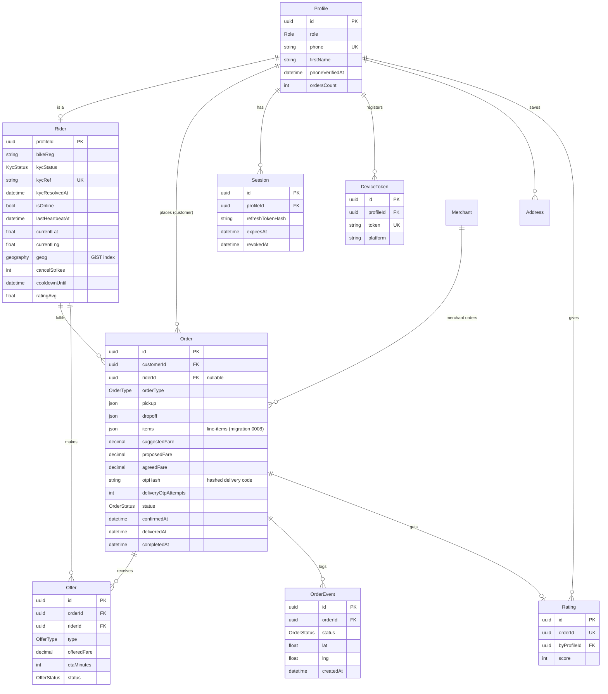

Load-bearing schema invariants (all enforced in the database, not just app code):

| Constraint | What it guarantees |
|---|---|
| `one_active_ride` — partial-unique index on `orders(rider_id)` over active statuses | A rider can be on **at most one active ride** at a time. The DB rejects a double-assign even under a race (ET2). |
| `offers` unique `(order_id, rider_id)` | **One offer per rider per order** — the "one round" rule as a constraint (ET7). |
| `riders_geog_gist` — GiST on `geog geography(Point,4326)` | Fast nearby-rider radius search via `ST_DWithin` (ET6). |
| `orders.otp_hash` + `otp_cipher` + `delivery_otp_attempts` | Delivery handover code: verified only against its HMAC hash, with a 5-attempt cap (ET7). Since owner decision D2 (2026-10-07, migration 0086) it is also stored AES-GCM-sealed (`PiiCryptoService.encryptCode`, its own key) so "show the code" returns the same code on every device instead of minting a new one; never plaintext, never logged. Each ciphertext is bound (AES-GCM AAD `"<kind>:<orderId>"`) to its order and code kind, so it can't be replayed onto another row; a rider-bail clone re-seals the carried code under its own id. A trigger from the same migration (`orders_clear_handover_ciphers`) nulls both ciphertexts on every terminal status and the pickup one once collected. `pickup_code_hash` + `pickup_code_cipher` do the same for the N-16 pickup code. A lockout re-issue (every try used) resets the tries, so it is capped per order and per code at `HANDOVER_CODE_MAX_REISSUES` (2; `delivery_code_reissues` / `pickup_code_reissues`), pinned on the lock so two devices make one new code; past it the API refuses (`code_reissue_limit` / `pickup_code_reissue_limit`). `POST /orders/:id/deliver` and `/merchant/orders/:id/confirm-pickup` are throttled per rider (10/min). |
| `sessions.refreshTokenHash` (hashed) + `revokedAt` | Server-owned sessions → real revoke/logout/ban (ET5). |

---

## 6. The offer loop (core sequence)

This is the heart of the parcel product and the trickiest concurrency surface. A customer broadcasts a
price; online, KYC-verified riders anywhere in Zimbabwe respond once each; the customer selects one;
assignment is a **guarded compare-and-swap** so a concurrent select and the expiry timer can never
double-assign. (Merchant orders don't use this loop; see [§7](#merchant-orders-restaurants-shops-pharmacy).)

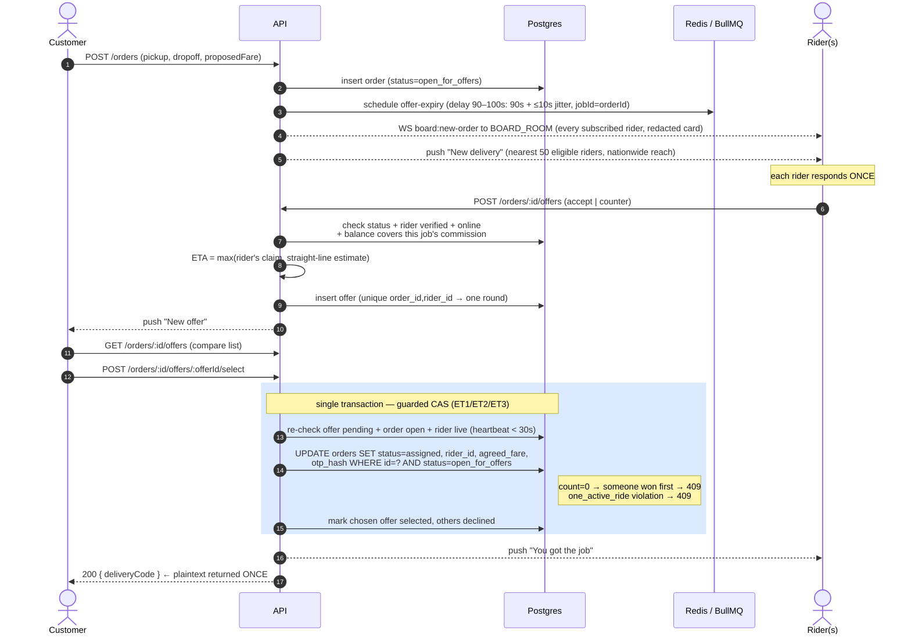

What makes the select safe:

- The `UPDATE ... WHERE status = 'open_for_offers'` is the CAS. **First writer wins**; a second
  concurrent select (or the expiry job firing at the same instant) sees `count = 0` and returns a
  409, so the order can never be assigned twice.
- The `one_active_ride` index makes the DB reject a rider who is somehow selected on two orders at
  once (caught as a `P2002` → 409).
- **Liveness is checked inside the transaction**: the selected rider must be `isOnline` with a
  heartbeat newer than 30s, or the select is rejected ("pick another").
- The **delivery code is minted here, hashed, and stored**; the plaintext is returned to the
  selecting customer. D2 (owner 2026-10-07): it is also stored sealed (`otp_cipher`), so the
  customer's other devices read the SAME code back through `POST /orders/:id/delivery-code/reveal`
  (idempotent; never rotates, never resets the tries). A rider-bail re-broadcast clone carries the
  trip's code and this select keeps it, so the recipient's code survives a re-match (U22).
- The expiry path (`expireOrder`) runs the *same* guarded CAS: if a customer already selected, the
  order is no longer `open_for_offers`, so the expiry no-ops. Idempotent by construction.

How the broadcast reaches riders (nationwide, ledger D-99):

- **One rule for where we serve.** `isInServiceArea` (`packages/shared/src/service-area.ts`) is the
  Zimbabwe border plus a 10 km margin. Every location check uses it: parcel pickup and drop-off,
  merchant delivery addresses, a rider going online, and where a merchant may register.
- **Reach is a pure function of order age** — `broadcastRadiusAtMs` on the shared `BROADCAST` policy
  (`packages/shared/src/policy.ts`). The base reach is `NATIONWIDE_REACH_M` (1,500 km) from creation and
  `BROADCAST.expansion` is empty, so nothing widens. The old 5 → 8 → 12 km widening ticks
  (`MatchingService.expandBroadcast`) are a dormant hook: with an empty schedule none are scheduled.
  The base reach is still deploy-tunable (`BROADCAST_BASE_RADIUS_M`, resolved in
  `apps/api/src/common/broadcast-policy.ts`).
- **The board.** Every eligible rider who sends `board:subscribe` joins the one `BOARD_ROOM`
  (`tracking.gateway.ts`); a new order is emitted there as a redacted card. The REST board
  (`GET /orders/open`) lists every open order, nearest first, with the rider's distance.
- **The push.** `TrackingService.nearbyRiders` picks the **nearest 50** eligible riders (online,
  `active`, verified, a live position, and a heartbeat inside the push cutoff) and FCM/APNs-pushes them.
  A per-order Redis set (`broadcast:sent:<orderId>`) is claimed first so a rider is pinged once per order.
  So the board reaches everyone; the push reaches the nearest 50.
- **Ghost riders are filtered.** The customer-facing `ridersNearby` count and the push use heartbeat
  cutoffs (120 s strict, 15 min for push, `BROADCAST.heartbeatMaxAgeMs*`). Selection uses a stricter
  **30 s in-transaction gate**. Idle riders heartbeat every 20 s.
- **Commission cover.** Once a rider's 10 free jobs are used, a bid is refused if their wallet balance
  doesn't cover this job's commission (`canCoverJobCommission`, `common/commission-cover.ts`). The same
  check runs again at select time.
- **ETA floor.** The API keeps the larger of the rider's tapped ETA and `estimatePickupEtaMinutes` from
  their distance, so a far-away rider can't rank as "sooner" ([PRICING](PRICING.md)).

---

## 7. Order lifecycle state machine

After assignment, the rider drives the trip forward one step at a time. Each forward edge is its own
guarded CAS (flips only from the expected prior state, and only for the assigned rider), so a
duplicate tap or a concurrent call can never skip or repeat a step. `delivered` is OTP-gated;
`completed` is reached by a customer rating **or** the auto-close backstop.

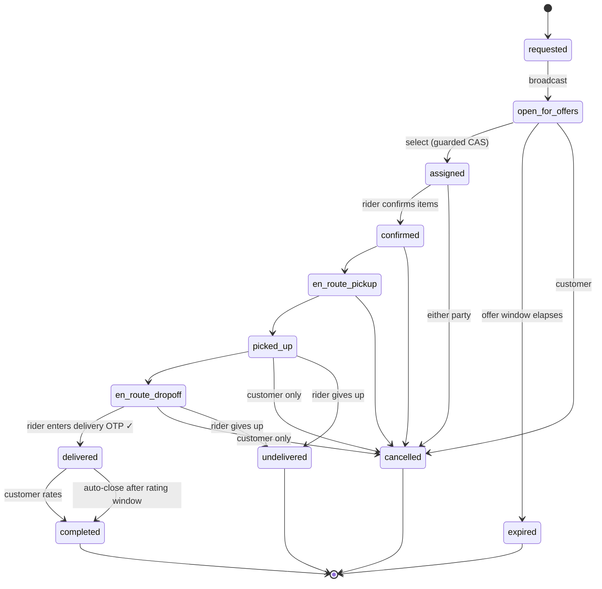

> **Machine-checkable mirror.** `apps/api/src/orders/order-lifecycle.transitions.ts` holds one
> declarative `TRANSITIONS` table (from × event → to, with the guard, side effects and `file:method`
> source of each edge), asserted by `order-lifecycle.transitions.spec.ts`. It is a verification artifact;
> nothing consumes it at runtime. **`requested` is never written for a parcel:** `create()` mints a
> parcel directly at `open_for_offers`. Merchant orders are born at `requested` (see
> [Merchant orders](#merchant-orders-restaurants-shops-pharmacy) below).

Rules encoded around the transitions:

- **Delivery OTP**: `confirmDelivery` takes a row lock (`SELECT ... FOR UPDATE`) so the attempt-count
  gate, the constant-time hash compare, and the increment are point-in-time consistent — no
  concurrent-guess bypass of the 5-attempt cap. A wrong code is **committed** (the increment
  persists); only the error path rolls back. After a lockout the customer can `rotate` a fresh code.
- **Cancellation windows** differ by party: a customer may cancel at any live status, pre- or
  post-pickup; a rider may cancel only up to `en_route_pickup` — once the parcel is on the bike, a
  rider giving up moves the order to `undelivered` instead (below), not `cancelled`. A **rider
  cancel is a no-show strike** — every 3rd strike forces the rider offline on a 2-hour cooldown (T4).
  **Automatic penalties are suspended by default** (`PENALTIES_SUSPENDED`, unset = suspended;
  `apps/api/src/common/penalties.ts`): strikes and reliability are still recorded, but no cooldown,
  reliability hold, abandonment hold, merchant cash lock or customer cash ban takes effect, and ones
  already on record are ignored (not cleared). Admin suspend/ban and security limits are unaffected.
- **Undelivered**: from `picked_up` or `en_route_dropoff`, a rider who cannot complete the hand-off
  moves the order to the terminal `undelivered` state via a guarded CAS (`markUndelivered`), with a
  reason and attempt count recorded and shown to the customer.
- **Rating closes the order** and always updates `tripsCount` in the same transaction, but
  `ratingAvg`/`ratingCount` and reliability recovery only move when the rating **counts toward the
  aggregate** — a distinct rider/customer pair (`priorPairRatings === 0`, anti-farming, FRAUD P1-6)
  **and** an established customer (`customerRatingCarriesWeight`, `>= CUSTOMER_TRUST.minCompletedOrders`
  prior completed orders — anti-sock-puppet). A low rating from an established customer still applies
  its reliability penalty even on a repeat pair; an untrusted customer's rating moves neither direction.
  If the customer never rates, the auto-close backstop still completes the order so metrics don't stall
  ([§14](#14-background-jobs--self-healing)); it credits the clean-completion recovery and records the
  points it actually credited (post-clamp) on `orders.auto_close_reliability_credit`. A **late rating**
  (within `RATE_LATE_WINDOW_MS`, 7 days of the delivery) **replaces** that credit (owner 2026-10-02):
  it reverses exactly the recorded points, then applies the rating's normal on-time effect, and nulls
  the column under a CAS in the same transaction so the reversal happens once. An order completed with
  no recorded credit (ops adjudication, or a pre-0069 auto-close) keeps the older late rule: only a
  low rating's penalty applies.
- Every transition writes an `order_event` row (the audit/tracker trail) and best-effort emits a WS
  `order:status` event plus an FCM push.

### Merchant orders (restaurants, shops, pharmacy)

A merchant order (`orderType = merchant`) reuses the `OrderStatus` skeleton. While the venue handles it,
the order sits at `requested` and a second column, `merchantPhase`, carries the kitchen sub-state. Once a
rider holds the job it joins the same delivery states as a parcel. Code: `apps/api/src/merchant/`;
money, timing and dispatch constants: `packages/shared/src/restaurants-order.ts`; the transition table
for both types: `apps/api/src/orders/order-lifecycle.transitions.ts` (`MERCHANT_PHASE_TRANSITIONS`).

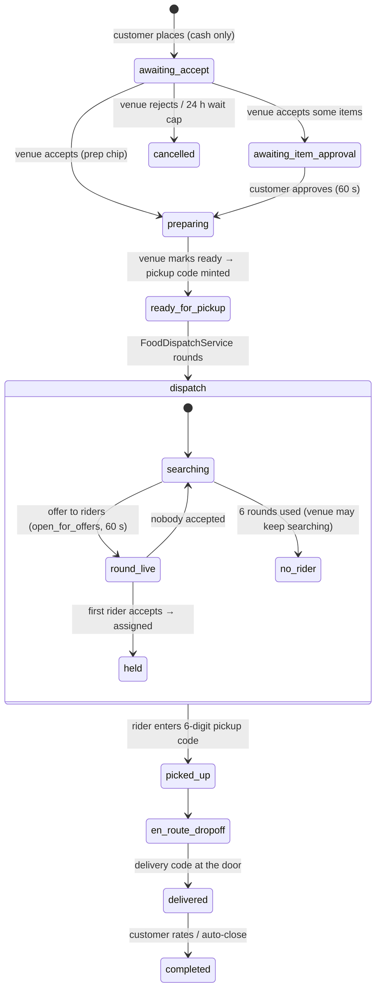

- **Placement** (`FoodOrderService.placeOrder`, `POST /restaurants/:merchantId/orders`). Cash only: a
  `wallet` payment is refused (`wallet_not_accepted`, ledger D-74). The API prices the order itself —
  goods total, a $1 small-order fee under $4, and `deliveryFeeForDistance(km)` from the venue to the
  drop-off — and snapshots any venue-funded delivery share (D-71). Pharmacy lines that need a
  prescription carry an `OrderPrescription` the pharmacist must approve before the order can be marked
  ready.
- **The venue's wait.** The accept window shown is 3 minutes, but nothing cancels a merchant order for a
  merchant wait inside `MERCHANT_WAIT_CAP_MS` (24 h, owner decision D1). The customer gets "still
  waiting" pushes at 3 and 15 minutes and may cancel free until the venue accepts. Auto-accept venues
  (`RESTAURANTS_AUTO_ACCEPT`) skip the window, and their rider search starts before the food is ready.
- **Item changes.** A partial accept asks the customer to approve within 60 s; a substitution round
  (`OrderSubstitutionService`) gives 3 minutes; no answer drops those lines. The order can't go to a
  rider while a round is open.
- **Dispatch** (`FoodDispatchService`). Unlike the parcel loop, there is no customer choice and no
  bidding: the first rider to accept gets the job. Round 1 offers it to the best 10 eligible riders (the
  venue's own riders first, within a 2 km slack, then the nearest); later rounds offer it to everyone
  eligible. Reach is **15 km** from the venue (`RESTAURANTS_DISPATCH.pickupReachM`), not nationwide —
  food can't wait for a rider from another city. Six 60-second rounds, then a "no rider" hold the venue
  can resume or cancel. A rider who passes is not asked again for 10 minutes. The commission-cover check
  applies at accept.
- **Pickup.** The venue's 6-digit pickup code (shown 3 + 3) is hashed and sealed like the delivery code.
  The rider enters it (`POST /merchant/orders/:id/confirm-pickup`, throttled); a geofenced "collected"
  (150 m) is the fallback for auto-accept venues. A sealed-bag photo is captured.
- **Cash at the door** (`FoodDebtService`). The customer and the rider each confirm the cash changed hands.
  If the venue's cash rule is `collect_and_return`, a `MerchantDebtLedger` row opens at pickup and settles
  when the rider returns the venue's money (or it is written off); `pay_upfront` venues were paid at the
  counter, so no debt opens. Automatic cash locks and bans are off while penalties are suspended.
- **Reconcilers.** A 20-second DB sweep (`RESTAURANTS_TIMING.sweepIntervalMs`) handles the wait cap,
  item-approval and substitution windows, end-of-day close and dispatch rounds — DB-driven, not BullMQ.

The merchant side also books Send parcels for itself ("Book a rider", `MerchantBookingService`,
`/merchant/bookings`): it goes through the normal parcel offer loop as the business's booking account,
and the business picks from offers ranked with a preferred-rider bonus ([PRICING §5](PRICING.md)).

---

## 8. Authentication (OTP + JWT sessions)

Phone-first, passwordless. A one-time code proves phone ownership. The channel is `OTP_CHANNEL`
(`whatsapp` Cloud API, `bird` SMS, `bird-verify` — WhatsApp first with SMS fallback — `local-sms`, or
`console` in dev only; `apps/api/src/auth/`). The release workflow defaults it to `whatsapp`; the live
value is a repo Variable. After the code, the API issues a short-lived access JWT plus a **server-stored, rotating refresh token** so
logout/revoke/ban are real. OTP codes and refresh secrets are only ever stored as HMAC hashes.

```mermaid
sequenceDiagram
    autonumber
    actor U as User
    participant API as AuthService
    participant Store as Redis (OTP + rate limit)
    participant WA as WhatsApp / sender
    participant DB as Postgres

    U->>API: POST /auth/otp/request { phone }
    API->>Store: rate-limit (per-phone / per-IP / global)
    API->>Store: put hash(code), TTL 300s
    API->>WA: send 6-digit code
    API-->>U: { sent: true }  (never reveals if phone exists)

    U->>API: POST /auth/otp/verify { phone, code }
    API->>Store: get record, check attempts (< 5)
    API->>API: constant-time compare hash(code)
    API->>DB: upsert profile (create if new)
    API->>DB: create Session (store hash(refreshSecret))
    API-->>U: { accessToken, refreshToken=sessionId.secret, needsProfile }

    Note over U,API: access JWT expires (15 min)
    U->>API: POST /auth/refresh { refreshToken }
    API->>DB: load session, check hash+expiry (hard gate);<br/>reject if rider is suspended/banned (IR16-01);<br/>if revoked-by-rotation with an un-consumed successor,<br/>hand back THAT successor (lost-response replay, SES-02);<br/>otherwise reject
    API->>DB: one transaction: revoke old (CAS) + create successor + link (rotation)
    API-->>U: fresh { accessToken, refreshToken }

    U->>API: POST /auth/logout → revoke the chain's live head
```

Security properties baked in:

- **Access token** = HS256 JWT, 15-min TTL, carries `sub` (profileId) + `role`; role is re-checked
  server-side per request, never trusted blindly.
- **Refresh token** = `sessionId.secret`; only `hash(secret)` is stored. Every refresh **rotates**
  (old session revoked, successor minted and linked — one transaction), so a stolen-and-replayed
  refresh token is detectable. The successor's secret is derived from the presented token
  (`TokenService.successorSecret`, a keyed HMAC), which makes rotation **idempotent**: a client whose
  rotate response was lost (dropped link, the app killed or the phone switched off before it saved the
  new token) re-presents its old token and gets the SAME successor back — no new session is ever
  minted by a replay — for as long as that successor is unused and within 14 days of the rotation
  (`REFRESH_REPLAY_WINDOW_MS`, clamped down to `SESSION_RETENTION_DAYS`; `AuthService.replayRotation`;
  SES-02). Replays are logged, as is a rotated token that returns after its successor was used.
  Concurrent refreshes of one token converge on one successor. Reuse after the successor was consumed, a logout- or admin-revoke, or a plain expiry all
  still hard-reject. Logout revokes the chain's live head even when the presented session id was
  already rotated away (SES-06). A database error during refresh is a 5xx, never a 401 (SES-01).
- **Rate limiting** on OTP send is three-tiered (phone / IP / global) because each WhatsApp send
  costs money — enumeration is a budget-DoS, not just spam (ET5).
- The **response never reveals whether a phone exists** (always "sent"). A dev/QA escape hatch
  returns the code inline, but only on the `console` channel and only for allowlisted test numbers.
- On the client, `apiFetch` **single-flights concurrent 401 refreshes** so two pollers don't both
  refresh (the second would use a token the first just rotated away and trigger a false sign-out).
  Only the API's own JSON 401/403 from `/auth/refresh` signs the user out — a proxy/WAF/captive-portal
  page does not (SES-05). Session keychain writes are serialized, never fail the sign-in or request
  that caused them, and are retried when the app backgrounds; a throwing keychain read is retried
  before it is believed as "signed out" (SES-04). Screens patch the session with `updateSession`,
  never by writing back a render-captured copy (SES-03). The session is process state, so a remount
  (the root ErrorBoundary's "Reload") continues from it instead of the launch read (SES-09).

---

## 9. Rider onboarding & KYC

A customer upgrades to a rider by submitting bike details + a photo; ID verification runs through
Didit (Zimbabwean national IDs). The webhook is HMAC-verified and applied **monotonically** so a
replayed or out-of-order delivery can't overwrite a newer decision. `KYC_MODE` and `KYC_PROVIDER`
switch between the real vendor, manual admin review, and a CI/QA stub; production runs
`KYC_PROVIDER=didit`, `KYC_MODE=auto` (the release workflow's defaults).

**KYC is fully automatic** (owner, KYC-R26-12). `applyDiditDecision` (`apps/api/src/kyc/didit-decision.ts`)
is the one path for both the webhook and the lost-webhook reconciler (`KycReconcileService`). Didit's
verdict decides; the face-match score can only tighten it. `KYC_THRESHOLDS.autoApprove` and
`needsReview` are both 0.60 (`packages/shared/src/policy.ts`), so there is no hold-for-a-human band:
Didit's "In Review" and a sub-threshold score are declines. Only a session Didit never finished judging
stays `pending`. The admin override below is a support backstop, not a review queue.

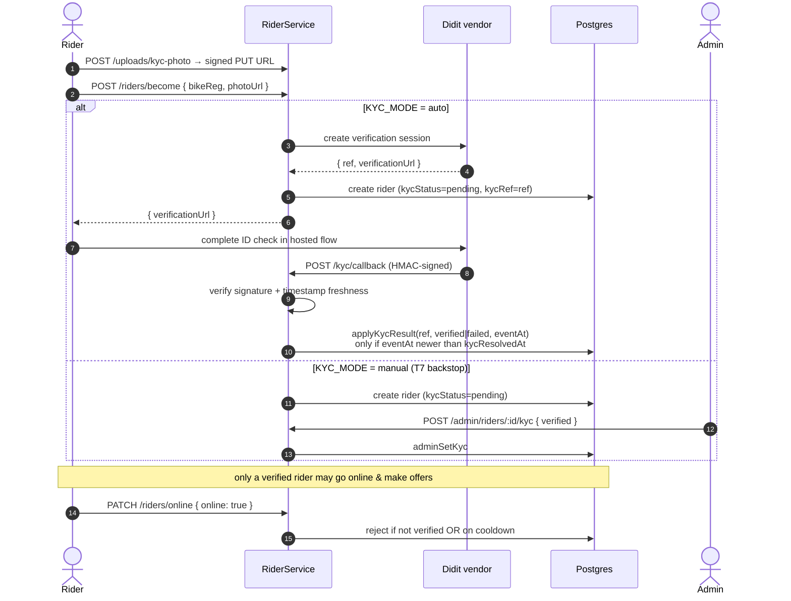

- **Gating**: `PATCH /riders/online` and `POST /orders/:id/offers` both require `kycStatus=verified`,
  `accountStatus=active` (not suspended/banned), a position inside Zimbabwe, and — only while penalties
  are on — no automated reliability hold (`onHold=false`) and no cooldown (`online-gate.ts`'s
  `onlineRefusalReason`). With `PENALTIES_SUSPENDED` (the default) holds and cooldowns on record are
  ignored.
- **Commission (live).** The rate is 10% (`COMMISSION.ratePct`; the server resolves
  `COMMISSION_RATE_PCT`). A rider's first 10 completed jobs are free (`COMMISSION.freeFirstJobs`). There
  is **no minimum balance** to go online (`lowBalanceBlockBelow = 0`). Instead, a rider can't take a job
  whose commission exceeds their balance (`canCoverJobCommission`, `common/commission-cover.ts`): checked
  when they bid on a parcel, when the customer selects them, and when they accept a merchant dispatch.
  The refusal reason is `commission_low_balance`. The debit itself happens at completion, in the
  completion transaction, at most once per order (§13).
- **Webhook idempotency**: `applyKycResult` updates only when `kycResolvedAt` is null or older than
  the incoming `eventAt`. `kycRef` is unique → matches at most one rider. An exact replay has the
  same timestamp → not newer → ignored.
- **Signature**: the webhook body is canonicalized (recursive key sort) and HMAC-verified against the
  raw request body (why `rawBody` is enabled at bootstrap), with a timestamp-freshness check.
- **Stub provider** (`KYC_PROVIDER=stub`, the env default) auto-passes in `auto` mode, so the full rider
  flow is testable in CI with no Didit account. Production refuses to boot with it (`config/env.ts`).
- **A fourth status, `expired`** (migration `0018`), covers a previously-verified rider whose national
  ID has since lapsed — reachable via the same webhook/admin-override paths as `failed`, and gates
  `online`/offers exactly like `pending`/`failed` until the rider re-verifies.

---

## 10. Live tracking (WebSocket)

A Socket.IO gateway pushes rider position and order-status changes to whoever is watching an order.
**WS is best-effort push only** — `GET /orders/:id` (REST) stays the source of truth on reconnect,
so a dropped socket self-heals via refetch. The Redis adapter fans events across API instances.

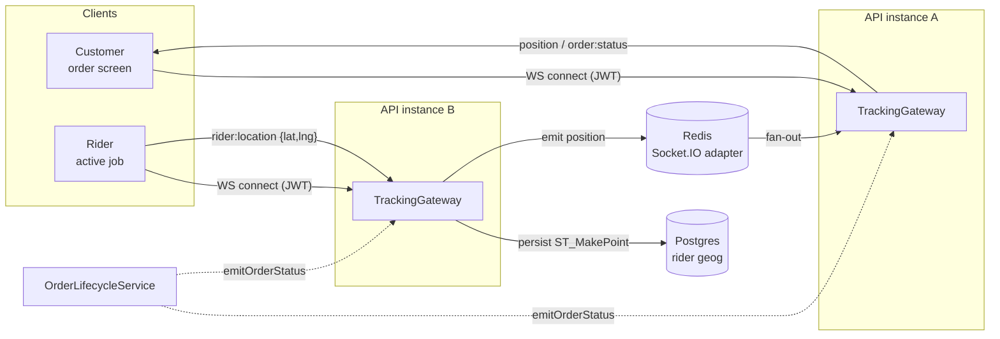

Flow details:

- **Connection auth**: the socket verifies the access JWT on connect (from `auth.token` or the
  `Authorization` header); an invalid/missing token is disconnected immediately.
- **`subscribe:order`**: server checks the caller is the order's customer *or* its assigned rider
  before joining the room (`canAccessOrder`).
- **`rider:location`**: only the **assigned rider on an active ride** may stream position
  (`isAssignedRider`). The position is persisted (`geog = ST_SetSRID(ST_MakePoint(...))`) so a
  reconnecting client's REST snapshot is fresh, then re-emitted to the room.
- **`order:status`**: emitted by the lifecycle service after a committed transition — wrapped so it
  can never throw into the caller's transaction.
- **`offers:changed`** (auction is **push, not poll**): during `open_for_offers` the offers service
  pushes a *signal-only* event (`orderId` + `at`, never offer contents) to the order room whenever the
  offer set changes; the customer refetches `GET /orders/:id/offers`, so rider PII stays on the
  authenticated REST path while the list updates in real time.
- **Rider board** (`board:subscribe` / `board:new-order` / `board:leave`): a verified, online rider in
  good standing joins the **one nationwide `BOARD_ROOM`** (D-99); a position, if sent, is ignored. A
  newly created open order is emitted there as a **redacted** card (point + landmark, never
  `contactPhone`, mirroring `GET /orders/open`), so riders see work the instant it's posted instead of
  polling. `bid:expired` / `order:taken` close cards the same way. The old `board:geo:*` cell rooms are
  gone; a re-subscribe still leaves any such room a socket from an older server joined. A suspended,
  banned or erased rider is evicted from the room post-commit.
- **Merchant queue** (`merchant:queue-subscribe` → `food:queue-changed`): a venue member's socket
  joins `merchantQueueRoom(merchantId)` (the server resolves the venue from membership). Any change to
  one of the venue's orders sends a signal-only event; the board refetches `GET /merchant/orders`.
- **Merchant dispatch offers** (`food:offer` / `food:offer-closed`) go to the individual riders offered a
  round, not to the board room.
- On the client, `useOrderSocket` applies `position` pushes to the React Query cache and, on
  connect / `order:status` / connect-error, **invalidates and refetches** the REST snapshot (the
  authoritative source). The screen also polls during active statuses as a second safety net.

---

## 11. Media uploads (signed URLs)

Photos (rider KYC/selfie, item photos, pickup and proof photos, dish and banner photos, prescription
pages) never transit the API. Clients upload bytes **directly** to Blob Storage with a short-lived
signed PUT URL — on Azure a **user-delegation SAS** that the API mints with its managed identity (no
account key exists). Only the resulting object key is persisted; read URLs are minted on demand.

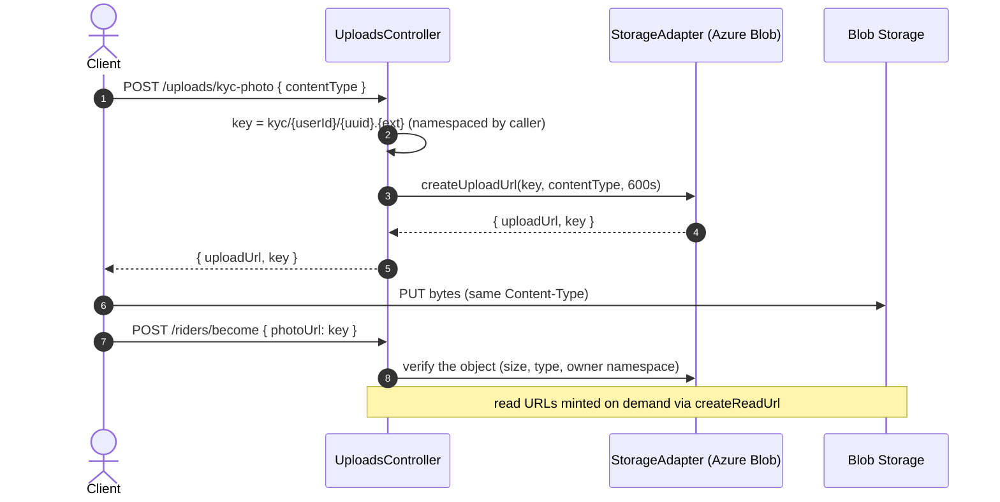

- **One table of upload kinds** (`adapters/storage/upload-kinds.ts`): each kind has its key prefix
  (`kyc/`, `pickup/`, `delivery-proof/`, `dish/`, `banner/`, `rx/`, …) and a size cap. Keys are
  `<prefix><ownerId>/<uuid>.<ext>`, so one user can't target another's path.
- The URL pins the **exact `Content-Type`** (JPEG/PNG), and the attach step checks the object is really
  in the caller's namespace before the key is stored (`upload-verifier.ts`).
- An **orphan sweep** (`storage-sweeper.ts`) deletes uploads older than 24 h that no row references. It
  runs as the second step of the daily retention job, not as an in-process timer.

---

## 12. The cloud-portable adapter seam

The things a cloud or vendor actually locks you into — object storage, secret access, push and payment
rails — sit behind interfaces. Business logic depends only on the interface; env picks the impl
(`CLOUD_PROVIDER`, `PUSH_PROVIDER`). The seam is what made the GCP → Azure move an adapter swap, not a
rewrite (D7).

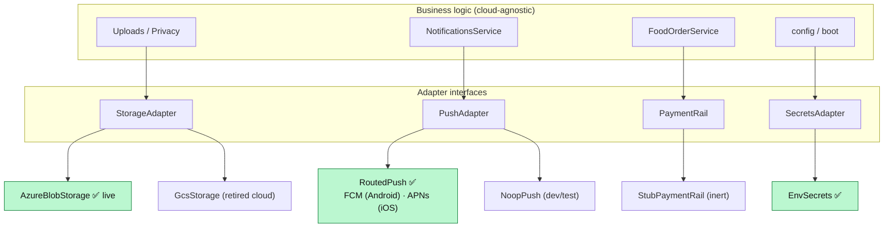

| Seam | Interface | Impls | Selector |
|---|---|---|---|
| Storage | `StorageAdapter` (`createUploadUrl`, `createReadUrl`, `deleteObject`, …) | `AzureBlobStorage` (user-delegation SAS), `GcsStorage` | `CLOUD_PROVIDER` (`azure` in production) |
| Push | `PushAdapter` (`sendEach`, batched) | `RoutedPush` over `FcmPush` + `ApnsPush`, `NoopPush` | `PUSH_PROVIDER` (FCM); APNs is on when its own credentials are set |
| Payments | `PaymentRail` (`initiate`, `confirm`) | `StubPaymentRail` only — no live rail ([PAYMENT-RAIL-OUTSTANDING](PAYMENT-RAIL-OUTSTANDING.md)) | bound in `PaymentsModule` |
| Secrets | `SecretsAdapter` | `EnvSecrets` | — |

Secrets arrive as **env vars**: Container Apps resolves Key Vault references into the container's
environment, so there is no cloud-specific secret-fetch code in the app.

---

## 13. Concurrency-safety model

Every state change that two actors could race is a **guarded compare-and-swap inside a
transaction**, backed by a **database constraint** as the last line of defense. This single pattern
recurs across the offer loop, the lifecycle, and the KYC webhook — it's the backbone of correctness.

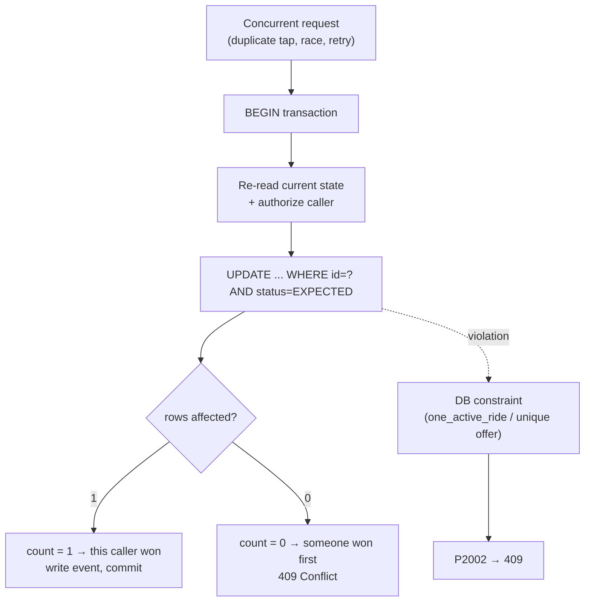

Where the pattern is applied:

| Operation | Guard | Backstop constraint |
|---|---|---|
| Select offer → assign | `UPDATE orders ... WHERE status='open_for_offers'` | `one_active_ride` partial-unique |
| Offer window expiry | same CAS (`WHERE status='open_for_offers'`) | idempotent job (`jobId=orderId`) |
| Make offer | insert with unique `(order_id, rider_id)` | rejects a second offer as 409 |
| Forward lifecycle step | `UPDATE ... WHERE status=<prior>` + rider check | one event row per real transition |
| Delivery OTP | `SELECT ... FOR UPDATE` row lock | 5-attempt cap, constant-time compare |
| Rate → complete | `UPDATE ... WHERE status='delivered'` | one `Rating` per order (unique) |
| KYC webhook | `updateMany ... WHERE kycResolvedAt < eventAt` | monotonic by event time |

The rule of thumb the codebase follows: **check-then-act is never split across statements** for
contended state — the guard lives in the `WHERE` clause of the write, so the database arbitrates the
race, and a unique index catches anything the guard misses.

### Idempotency inventory (money-moving & state-changing operations)

Retries and double-submits are a *when*, not an *if* (a hurried operator double-clicks; a 2G link drops
a response and the client resends). Every operation that moves money or changes durable state is
**exactly-once by construction** — a deterministic key, a CAS, or both. This table is the authority on
which mechanism protects each (roadmap 2.2 verification pass):

| Operation | Idempotency mechanism | Evidence |
|---|---|---|
| Top-up create (`POST /wallet/topups`) | client `idempotencyKey` → partial unique `(rider_id, idempotency_key)` | migrations 0028/0029; a retry hits the same pending intent (BH-09) |
| Top-up credit (rail / manual) | credit CAS transitions `pending→confirmed` + unique `topUpId` on the ledger row | exactly-once credit; a replayed confirm can neither re-transition nor double-credit |
| Admin manual credit | `providerRef @unique` (the form-open key); P2002 caught → returns already-credited balance | WD-003; `wallet.service.creditManual` |
| Per-ride commission debit | partial unique `(rider_id, order_id)` WHERE `type='ride_commission'` | WD-015 (migrations 0030/0031); one debit per order, ever. Live at 10% (§9) |
| Merchant cash debt | `@@unique([orderId, type])` on `MerchantDebtLedger` | at most one `opened` and one settling row per order |
| Fare adjust | **no-op guard** (adjust-to-current short-circuits) + `agreedFare` CAS | AH20-01 (roadmap 2.2); a same-value replay writes nothing |
| Refund (issue resolve) | refund created **inside** the issue-resolve CAS (`WHERE status != 'resolved'`) | AH20-02 verified; a second resolve gets 409, so at most one refund per issue |
| Order lifecycle transitions | status-guarded CAS (`WHERE status=<prior>`) | §13 table above; one event per real transition |
| Offer make / select | unique `(order_id, rider_id)` / `one_active_ride` | §13 table above |

Deliberately deferred (recorded in `TODOS.md` / roadmap): client-persisted stored-response replay
(Airbnb-style) — the server-side keys + CAS above already give exactly-once, so the client half is added
only if a real client-retry duplicate is observed. A future payment-rail webhook (no rail is wired yet;
see [PAYMENT-RAIL-OUTSTANDING](PAYMENT-RAIL-OUTSTANDING.md)) must dedupe inbound events by provider
event id and join this table.

---

## 14. Background jobs & self-healing

Two BullMQ queues (on Redis) drive the parcel's time-based transitions, each paired with a
**Redis-independent DB backstop** so a lost job or a Redis outage can't strand an order. Merchant orders
use DB sweeps only. Daily jobs run as Azure Container Apps jobs.

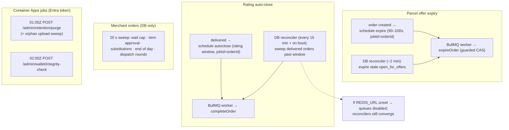

- **`jobId = orderId`** makes both BullMQ jobs idempotent — a retry or duplicate schedule can't fire the
  transition twice.
- **Offer-expiry delay is `OFFER_WINDOW_MS` (90 s) plus additive 0–10 s jitter → 90–100 s.** The jitter
  is additive-only so the job never fires before the customer's countdown hits zero; it just
  de-synchronises a burst of orders so their expiry transactions don't stampede.
- **Broadcast-widening ticks** (`expand:<orderId>:<step>`) share the offer queue and are best-effort, but
  with D-99's empty `BROADCAST.expansion` none are scheduled.
- The **rating auto-close reconciler** runs on boot and every 15 minutes, sweeping delivered-but-unrated
  orders past the rating window (batched, 500 at a time) — the backstop for a crash between commit and
  schedule, or a Redis outage.
- The **merchant sweeps** run every 20 s in the API process (`RESTAURANTS_TIMING.sweepIntervalMs`,
  `RESTAURANTS_DISPATCH.sweepIntervalMs`). That is one reason production keeps a minimum of one API
  replica.
- The **daily jobs** (`infra/azure/jobs.tf`) fetch an Entra token for the scheduler audience and POST the
  endpoints; the API accepts it through `AdminOrSchedulerGuard` (`SCHEDULER_AUTH=azure`). Each job
  retries once on failure; an alert fires on a failed or missed run.
- If `REDIS_URL` is unset entirely, offer expiry is disabled (logged) but the reconcilers still converge —
  the system degrades, it doesn't break.

### Retry ownership

Every request that fails can be re-executed by *some* layer, and the failure mode to fear is
**amplification** — several layers each retrying the same call turn a blip into a self-inflicted
outage (DoorDash's June-19th post), while an ambiguous money write retried without care double-charges.
The rule here is **one owner per flow, classify before retrying, default non-retryable** (Airbnb's
double-payment lesson). The table is the authority on who may retry what:

| Layer | Retries | Policy | Owns |
|---|---|---|---|
| **TanStack Query (reads)** | `shouldRetry`, cap 2 | Retry only a **retryable** `ApiError` (status 0 / 5xx); a 4xx is a deterministic answer and never retried; an outage *pauses* the query (`onlineManager`) rather than burning retries. | Idempotent GETs |
| **TanStack Query (writes)** | `mutations.retry = false` | **Non-retryable by default.** A money-moving / state-changing POST is never silently re-sent by the client. A per-mutation `retry:` is a deliberate, reviewed exception and must carry an idempotency key. | All mutations |
| **API client (`api/client.ts`)** | Single re-send after a 401 token refresh | Not a general retry — one replay of the original request with a fresh access token, guarded by single-flight refresh. | Auth token rotation |
| **BullMQ workers** | `attempts: 3`, exp. backoff 5s | The *server-side* owner of retrying time-based transitions. Idempotent via `jobId = orderId` (a retry can't fire the transition twice). | Offer expiry, rating auto-close |
| **DB reconcilers (`setInterval`)** | Periodic sweep (offer ~2 min, lifecycle ~15 min) | The Redis-independent backstop, not a retry of a specific call — re-derives the correct state from the DB. Guarded CAS so it converges, never double-acts. | Self-heal for lost jobs / Redis outage |
| **Socket.IO client** | Built-in reconnection | Transport reconnect only; on reconnect the client re-subscribes and the server re-emits a snapshot. Carries no mutation. | Live-tracking presence |
| **Container Apps jobs** | `replica_retry_limit = 1` | Retries the nightly POST once (retention purge, wallet integrity). Each endpoint is idempotent or read-only, so a retried run is safe. The migrate job never retries (a half-applied migration must not be re-run blindly). | Scheduled sweeps |

`ApiError.retryable` (`api/client.ts`) is the single per-error classifier both client policies read:
`true` only for a dropped link (status 0) or a transient 5xx. Everything else — including any error a
layer can't classify — is treated as non-retryable on the write path. A future payment-rail webhook
joins this table as its own row and must dedupe inbound events by provider event id.

**Central client reliability policy (C-O2, mobile).** DoorDash lesson 6 ("client reliability policy
belongs to the contract, not call sites") and lesson 7 (jitter over synchronized retries — see
`docs/archive/plans/2026-08-01-low-connectivity-program.md` §3). Before this, every mobile network edge
picked its own timeout constant independently (`client.ts` 15s, `uploads.ts` a duplicated "mirrors
client.ts" 15s, `places.ts` 8s, the feature-flags/version-gate boot checks 10s, the reachability
probe 5s) and TanStack Query's retry backoff was left at the library's un-jittered default.
`apps/mobile/src/net/network-policy.ts` is now the single source for both:

| Tier | Value | Used by |
|---|---|---|
| `RTT_BUDGET_MS` | 600 ms | The Harare 2G/3G floor every tier below is scaled from (program doc §1) |
| `PROBE_TIMEOUT_MS` | 5 s | `net/reachability.ts`'s `/health` recovery probe |
| `FAST_TIMEOUT_MS` | 8 s | `api/places.ts` (Places autocomplete/details — UI is actively blocking) |
| `BACKGROUND_CHECK_TIMEOUT_MS` | 10 s | `net/use-feature-flags.ts`, `net/use-server-version-gate.ts` (best-effort, fail-safe boot checks) |
| `STANDARD_TIMEOUT_MS` | 15 s | `api/client.ts` (`apiFetch`), `api/uploads.ts` (the raw-binary PUT) |

`fullJitterBackoffMs(attempt, {baseMs, capMs})` implements AWS full jitter
(`random(0, min(capMs, baseMs·2^attempt))`); `queryRetryDelayMs` wraps it (base 1200 ms ≈ 2×RTT, cap
4 s) and is wired as `queries.retryDelay` in `query/client.ts`, replacing the previously-implicit
library default. The reachability probe's own cadence (`nextProbeDelayMs`, 2s/4s/8s/16s/cap 30s) is
deliberately left un-jittered and untouched by this change: it's a single-device polling loop, not a
fleet-wide retry that can synchronize into a storm, and its exact schedule is asserted by
`reachability.test.tsx`.

**Naming the idempotency guarantee behind every retriable mutation.** The write-path default above is
non-retryable, but several flows still see a client-initiated resend — either TanStack reconciling a
409 (see the C-T1–C-T5 audits, program doc §5 Lane C) or a user re-tapping after a failure — and each
one is safe only because of a specific server-side guarantee, named here so a future retry path can be
checked against the same bar instead of re-deriving it:

| Retried mutation | Server-side idempotency guarantee |
|---|---|
| Order creation (`POST /orders`) | Partial unique index on `(customer_id, idempotency_key)` — client-generated nonce, migration `0021_order_idempotency_index` |
| Accept an offer (`selectM`, order/[id].tsx) | Transactional CAS (`updateMany` on `status`); a lost-response retry reconciles via `selectOfferReconciled` against a fresh `getOrder` |
| Rider bid / offer (`POST /orders/:id/offers`) | `@@unique([orderId, riderId])` on `Offer` (schema.prisma) — a retried bid lands on the same row |
| Delivery-code confirm (`confirmDelivery`) | `SELECT … FOR UPDATE` row lock + CAS on order status (`order-lifecycle.service.ts`); a 409 is reconciled client-side against true state, never treated as a bare failure |
| Pickup/delivery-proof attach | Same `FOR UPDATE` transaction pattern as `confirmDelivery` (`order-lifecycle.service.ts`) |
| `becomeRider` | 409 `already_rider` (`rider.service.ts`) reconciled client-side into success, not a dead-end error |
| KYC vendor webhook | Row lock + monotonic `kycResolvedAt` CAS (`rider.service.ts`) — a replayed/out-of-order webhook can only ever advance, never regress, resolution |
| Wallet top-up (`POST /wallet/topups`) | Partial unique index on `(rider_id, idempotency_key)`, migrations `0028_topup_idempotency_column` / `0029_topup_idempotency_index` |
| Merchant dispute open | Partial unique index on `(opened_by_profile_id, idempotency_key)`, migrations `0035`/`0036_issue_idempotency_*` |
| Commission/settlement ledger write | `@@unique([orderId, type])` on the ledger row — a retried settle call can never double-write |

### Core vs non-core (kill switches)

Uber's driver-app lesson: keep the **core** — the path a user cannot complete their job without —
deliberately small and un-disableable, and give everything **non-core** a kill switch that fails soft,
so a catastrophic failure in a peripheral feature can never block the core flow. Lynia's core is the
money path plus the two safety-critical surfaces:

| Tier | Surfaces | Kill switch? |
|---|---|---|
| **Core** (never disable) | auth/OTP · the offer loop · order lifecycle · wallet/commission · live tracking · SOS | **No** — by design. These cannot be turned off; a failure here is an incident, not a toggle. |
| **Non-core** (fail soft) | in-app notifications feed · reports surfaces · ratings-adjacent extras | **Yes** — flip the switch and the surface degrades to empty/disabled, never erroring into the core flow. |

Non-core switches follow the existing env-flag pattern (deploy-time, logged + revertible via Container
Apps revisions — the Airbnb "config changes are changes" guardrail for free), not a runtime DB flag (that
would be new admin product surface; deferred). Shipped switches:

- **`NOTIFICATIONS_FEED_ENABLED`** (roadmap 3.1) — `GET /notifications/feed` is a ~9-read synthesis
  off the money path; when `false` the endpoint returns an empty feed instead of running the query, so
  a slow/broken feed can't take down checkout. The client already renders an empty feed as its ordinary
  "nothing yet" state, so the degrade is invisible beyond the missing rows.
  `GET /notifications/unread-count` shares the switch (off ⇒ zero unread, which is what an empty feed
  means). `POST /notifications/read` and `POST /notifications/dismiss` deliberately do **not**: both are
  single-row writes that must keep working with the synthesis off, or flipping the switch would strand a
  stale "N new" hint that nothing could clear.

The rule: a new non-core surface ships with its kill switch from day one; core surfaces never get one.

---

## 15. CI / CD pipeline

**CI** (`ci.yml`) gates every PR and push. The API ships to Azure through **Release (Azure)**
(`release-azure.yml`). Other deploy lanes: `deploy-admin-azure.yml` (admin console),
`deploy-customer-web.yml`, `deploy-merchant-web.yml` and `deploy-website.yml` (Cloudflare Workers),
`terraform-apply-azure.yml` (infra, behind an approval gate), `rollback-azure.yml`, and the
dispatch-only mobile lanes (`mobile-release.yml`, `mobile-submit.yml`). The old GCP `release.yml` is
dead: GCP was suspended on 2026-09-17.

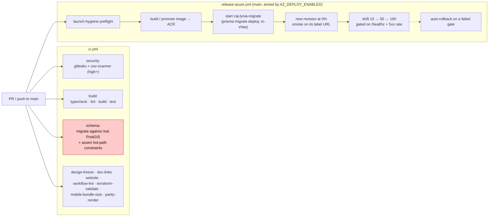

- The **schema job** runs migrations against a real PostGIS service and asserts the load-bearing
  constraints (`one_active_ride`, the GiST geo index, the hashed delivery code) actually applied.
- **Release** is gated on the repo Variable `AZ_DEPLOY_ENABLED == 'true'` and skips docs-only pushes. Its
  **launch-hygiene preflight** refuses a production deploy with the console OTP channel, test phones,
  the KYC stub, or an OTP/KYC vendor selected but not armed. With staging armed (`AZ_STAGING_ENABLED`) it
  first waits for the same commit to deploy green on staging.
- **Auth is OIDC only**: a federated credential per GitHub environment, with scoped roles and no Owner.
  No workflow reads a secret value; runtime secrets come from Key Vault references
  (`infra/azure/README.md`, S8).
- **Ownership split:** Terraform owns each app's shell (ingress, scale, identity, secret references);
  CI owns revisions, traffic and release-policy env. Terraform ignores `template` and traffic so an apply
  never rolls back a deploy.
- **Merging is not shipping** for mobile: builds are dispatched by hand with an explicit profile
  (`docs/PLAY-STORE-SUBMISSION.md`).

---

## 16. REST + WebSocket surface

The API surface, by module. All routes except `/auth/otp/*`, `/auth/refresh`, `/kyc/callback`,
`/webhooks/whatsapp`, `/handover/:token*` (signed-token auth) and `/healthz` require a bearer access
token; admin routes additionally require the `admin` role, and `/merchant/*` routes membership of a
business. The scheduled-job routes also accept the scheduler's Entra token. The controllers are the
authority; this table is a map.

### REST

| Method & path | Module | Purpose |
|---|---|---|
| `POST /auth/otp/request` | Auth | Send an OTP to a phone (rate-limited) |
| `POST /auth/otp/verify` | Auth | Verify OTP → issue session; upsert profile |
| `POST /auth/refresh` | Auth | Rotate refresh token → new session |
| `POST /auth/logout` | Auth | Revoke the current session |
| `GET /auth/me` | Auth | Authenticated profile (+ rider record) |
| `PATCH /auth/me` | Auth | Post-OTP profile setup (name) |
| `GET /app/bootstrap` | App (BFF) | Cold-start aggregate — profile + role-appropriate active order in one round trip (wave-2 perf) |
| `POST /orders` | Orders | Create a delivery, name a price → `open_for_offers` |
| `POST /orders/disclaimer` | Orders | Acknowledge the pre-broadcast disclaimer (A1-8) |
| `POST /orders/notify-me` | Orders | Register to be pinged when a rider comes online nearby (2·b1) |
| `GET /orders/open` | Orders | Open orders a rider can bid on |
| `GET /orders/mine/active` | Orders | Caller's active order |
| `GET /orders/history` | Orders | Caller's past orders |
| `GET /orders/earnings/summary` | Orders | Rider's true lifetime earnings total + trip count, server-aggregated (WD-004) |
| `GET /orders/:id` | Orders | Order snapshot (tracking source of truth) |
| `POST /orders/:id/offers` | Offers | Rider makes one offer (accept/counter) |
| `GET /orders/:id/offers` | Offers | Pending offers for the customer's list |
| `POST /orders/:id/offers/:offerId/select` | Matching | Customer selects → guarded assign |
| `POST /orders/:id/status` | Lifecycle | Rider advances one forward step |
| `POST /orders/:id/items/confirm` | Lifecycle | Rider ticks off sender's items at pickup |
| `POST /orders/:id/deliver` | Lifecycle | Rider submits delivery OTP → `delivered` |
| `POST /orders/:id/undelivered` | Lifecycle | Rider marks a failed hand-off → terminal `undelivered` (C6/F-02) |
| `POST /orders/:orderId/delivery-proof` | Lifecycle | Rider attaches an optional proof-of-drop photo + GPS on the undelivered flow (`KB-POD-DISPUTE` Phase A, IR16-11) |
| `POST /orders/:id/rating` | Lifecycle | Customer rates → `completed` |
| `POST /orders/:id/sender-rating` | Lifecycle | Rider rates the sender (recorded-only, rider-journey 4·7) |
| `POST /orders/:id/delivery-code/reveal` | Lifecycle | Customer reads the current delivery code (D2: same code every call/device, no rotation) |
| `POST /orders/:id/delivery-code/rotate` | Lifecycle | Customer re-issues delivery code — only a LOCKED code (the lockout re-issue, U04; capped per order at `HANDOVER_CODE_MAX_REISSUES`, resets the tries); while unlocked it returns the current code like reveal (a stale second device or an old build never kills the code). The merchant booking's "Send a new code" is the one unlocked replace (keeps the tries) |
| `POST /orders/:id/cancel` | Lifecycle | Either party cancels (rider = strike) |
| `POST /orders/:orderId/issues` | Issues | Party-facing "get help with this trip" (A-05) |
| `POST /orders/:orderId/report` | Reports | Report the order counterparty after a trip (A-05 adjacent) |
| `POST /orders/:orderId/sos` | SOS | Raise an SOS on a live trip (R-16/F-13) |
| `PATCH /riders/profile` | Riders | Complete signup (name + national ID) |
| `POST /riders/become` | Riders | Upgrade to rider; start KYC |
| `POST /riders/kyc/retry` | Riders | Re-run KYC (pending/failed) |
| `PATCH /riders/online` | Riders | Go online/offline (gated on KYC + standing + inside Zimbabwe — [§9](#9-rider-onboarding--kyc)) |
| `POST /riders/heartbeat` | Riders | Lightweight liveness beat — position + presence only, same standing enforcement as `PATCH /riders/online` (wave-2 perf) |
| `GET /riders/nearby` | Tracking | Nearby online riders (PostGIS radius) |
| `GET /wallet/config` | Wallet | Commission policy (rate, free jobs, floor = 0, top-up bounds) |
| `GET /wallet` | Wallet | Rider's prepaid commission balance |
| `GET /wallet/ledger` | Wallet | Reverse-chronological wallet ledger page (`?cursor=`) |
| `POST /wallet/topups` | Wallet | Start a top-up intent (rate-limited, server-clamped amount; no rail confirms it yet) |
| `GET /wallet/topups/:id` | Wallet | Poll a top-up intent until it reaches a terminal state |
| `POST /uploads/kyc-photo` | Uploads | Mint a signed PUT URL for a photo (also `pickup-photo`, `delivery-proof`, `merchant-dish-photo`, `merchant-banner-photo`, `prescription-photo`) |
| `POST /uploads/delivery-proof` | Uploads | Mint a signed PUT URL for the rider's proof-of-drop photo (`KB-POD-DISPUTE` Phase A, IR16-11) |
| `GET /notifications/feed` | Notifications | Caller's in-app notifications feed (customer-journey A·3) |
| `GET /notifications/unread-count` | Notifications | Unread row count, for the Account row's "N new" hint |
| `POST /notifications/read` | Notifications | Stamp the read watermark (the centre gained focus) |
| `POST /notifications/dismiss` | Notifications | Dismiss one feed row by its synthetic id (the swipe) |
| `POST /notifications/device-token` | Notifications | Register an FCM device token |
| `DELETE /notifications/device-token` | Notifications | Drop a device token |
| `POST /client-metrics` | Observability | Client RUM ingest (glass-to-glass / REST latency samples) |
| `DELETE /auth/me` | Privacy | Right to erasure — caller deletes their own account (CDPA) |
| `POST /admin/retention/purge` | Privacy | Retention sweep + orphan upload sweep (admin or the daily scheduler job) |
| `POST /admin/wallet/integrity-check` | Wallet | Nightly wallet ledger integrity check (admin or the daily scheduler job) |
| `POST /kyc/callback` | KYC | Didit HMAC-signed webhook |
| `GET /webhooks/whatsapp` | Auth | Meta subscription-verify handshake (`hub.verify_token`/`hub.challenge`) |
| `POST /webhooks/whatsapp` | Auth | WhatsApp delivery-status events, HMAC-signed (observability-only) |
| `POST /admin/riders/:id/kyc` | KYC | Admin KYC override (manual backstop) |
| `GET /admin/overview` | Admin | Dashboard counts |
| `GET /admin/sos` | Admin | Recent SOS events, newest first (DS13-05, `?limit=`) |
| `POST /admin/sos/:id/ack` | Admin | Acknowledge an SOS event (idempotent, CAS-guarded, audited) |
| `GET /admin/riders` | Admin | Rider roster / KYC review queue (`?kyc=`) |
| `GET /admin/riders/:profileId/kyc` | Admin | KYC doc-review detail for one rider (A-02) |
| `GET /admin/riders/:profileId` | Admin | Rider detail: stats, strikes, cooldown, bike, recent trips (D-2) |
| `POST /admin/riders/:id/suspend` | Admin | Suspend a rider (reason required) |
| `POST /admin/riders/:id/lift` | Admin | Lift a rider suspension (reason optional) |
| `POST /admin/riders/:id/ban` | Admin | Permanently ban a rider (reason required) |
| `POST /admin/riders/:id/clear-hold` | Admin | Clear an automated reliability hold on a rider (reason optional) |
| `GET /admin/orders` | Admin | Order list for the console (`?status=`) |
| `GET /admin/orders/:id` | Admin | Order detail: 8-step timeline, parcel, fares, masked people (D-2) |
| `POST /admin/orders/:id/cancel` | Admin | Admin-cancel an order (reason required) |
| `POST /admin/orders/:id/fare` | Admin | Adjust an order's agreed fare (manual correction / dispute) |
| `POST /admin/orders/:id/adjudicate-delivered` | Admin | Force-complete a rider-raised `undelivered` order over a withheld delivery code (`KB-POD-DISPUTE` Phase B, IR16-12, CAS-guarded, reason required) |
| `GET /admin/customers` | Admin | Customers directory (D-2, `?filter=`) |
| `GET /admin/customers/:profileId` | Admin | Customer detail: aggregates + recent orders (D-2) |
| `POST /admin/customers/:id/hold` | Admin | Place a customer on hold — blocks new broadcasts (S·2) |
| `POST /admin/customers/:id/lift` | Admin | Lift a customer hold (reason optional) |
| `POST /admin/audit-actions` | Admin | Persist a console ConfirmModal audit action (A-01) |
| `GET /admin/cash/settlements` | Admin | Read-only commission overview (prepaid model) |
| `POST /admin/riders/:id/wallet-credit` | Admin | Record an off-app rider payment as a wallet credit (audited, idempotent) |
| `GET /admin/riders/:id/wallet` | Admin | The biker statement: ledger rows with order / top-up / rate / actor, plus balance, free jobs left, pending commission, last top-up |
| `POST /admin/riders/:id/wallet-reversal` | Admin | Admin correction: a capped `reversal` debit, reason + note required, may name the credit it corrects (audited, idempotent) |
| `GET /admin/cash/topups` | Admin | Every top-up intent, 50 a page; `?filter=` a status or an open anomaly (`short_paid`, `paid_on_declined`) |
| `POST /admin/topups/:id/{repoll,credit-paid,resolve}` | Admin | Ask Paynow now · credit what Paynow reported paid (exactly once) · close an anomaly (all reason-coded, audited) |
| `GET /admin/cash/money` (`/csv`) | Admin | Platform money by Harare day (7 / 30): top-ups, fees, commission, manual credits, reversals; float, receivable, last integrity check |
| `GET /admin/cash/owed` | Admin | Bikers with a negative balance, longest owing first |
| `GET /admin/funnels` | Admin | One happy-path funnel (`?kind=biker\|customer\|merchant`, `?range=today\|7d\|30d`, Harare days): per step the count, conversion, median time and a `since` day where data starts with PR 2 |
| `GET /admin/stuck` | Admin | `?list=<key>`: one stuck list, oldest first (age, link, phone, push reachability, last nudge); `?kind=`: every list of a side with counts |
| `POST /admin/nudge` | Admin | Push a stuck person their list's fixed copy (push only); one per person per list per Harare day; reason-coded, audited (`person.nudge`) |
| `GET /admin/issues` | Admin | Disputes queue, newest first (A-05, `?status=`) |
| `GET /admin/issues/:id` | Admin | Per-issue detail incl. order evidence + masked phones |
| `POST /admin/issues/:id/resolve` | Admin | Resolve an issue (refund / rider_strike / close_no_action) |
| `GET /healthz` | Health | Liveness (`{status, db, redis}`) |

**Merchant verticals** (`apps/api/src/merchant/`, grouped — see each controller for the full list):

| Route group | Who | Purpose |
|---|---|---|
| `GET /restaurants`, `/restaurants/search`, `/restaurants/:id/menu`; `GET /shops`, `/shops/:id/catalogue` | Customer | Browse venues (behind the restaurants/shops feature guards) |
| `POST /restaurants/:merchantId/orders` | Customer | Place a merchant order (cash only) |
| `GET/POST /restaurants/orders/:orderId/*` | Customer | Order detail, item approval, substitutions, cancel, venue rating, cash confirm, schedule, prescription |
| `POST /merchant/become`, `GET /merchant/me`, `PATCH /merchant/{profile,hours,location,cash-rule,open,order-settings,busy-mode}` | Merchant | Venue setup and settings |
| `/merchant/categories`, `/merchant/dishes` | Merchant | Menu |
| `GET /merchant/orders`, `POST /merchant/orders/:orderId/{accept,reject,mark-ready,extend-prep,edit-items,substitution,confirm-kitchen,…}` | Merchant | The order board and kitchen actions |
| `POST /merchant/orders/:orderId/prescription/{approve,decline,saw-original}` | Merchant (pharmacist) | Prescription check |
| `GET /merchant/orders/dispatch/offer(s)`, `POST /merchant/orders/:orderId/dispatch/{accept,decline,drop}` | Rider | Merchant dispatch offers |
| `POST /merchant/orders/:orderId/{confirm-pickup,collected,pickup-proof,door-proof,doorstep/arrived,cash/rider-confirm,cash/dispute}` | Rider | Pickup code, proofs, cash handshake |
| `/merchant/bookings/*` | Merchant | "Book a rider" for the venue's own parcels |
| `/merchant/team`, `/merchant/invites`, `/merchant/riders`, `/merchant/branches` | Merchant | Team, invites, preferred riders, branches |
| `GET /merchant/statement/weekly`, `/merchant/summary/{today,week}` | Merchant | Money and KPIs |
| `GET /handover/:token`, `POST /handover/:token/confirm` | Rider (no login) | Signed 15-minute link to enter a pickup code without the app |

### WebSocket (Socket.IO)

| Direction | Event | Meaning |
|---|---|---|
| client → server | `subscribe:order { orderId }` | Join an order room (customer or assigned rider) |
| client → server | `rider:location { orderId, lat, lng }` | Assigned rider streams position |
| client → server | `board:subscribe { lat?, lng? }` | Verified, online rider joins the nationwide `BOARD_ROOM` (a position is accepted and ignored) |
| client → server | `board:leave` | Rider leaves the board (go-offline / unmount) |
| server → client | `position { riderId, lat, lng, at }` | Live rider position to the room |
| server → client | `order:status { orderId, status, at }` | Order status changed |
| server → client | `offers:changed { orderId, at }` | The order's offer set changed — signal only (no rider PII); the customer refetches the offer list |
| server → client | `board:new-order { … }` | A new open order pushed to the rider board — redacted (point + landmark, never `contactPhone`) |
| server → client | `bid:expired` / `order:taken` / `job:cancelled` | Close a board card or a rider's job |
| server → client | `order:rebroadcast { … }` | The assigned rider bailed; the order was re-broadcast as a new order |
| server → client | `presence:stale` / `presence:recovered` | The counterparty's socket went dark / came back |
| client → server | `merchant:queue-subscribe` | A venue member joins their merchant's queue room |
| server → client | `food:queue-changed { orderId }` | Something on the venue's queue changed — signal only; refetch |
| server → client | `food:offer` / `food:offer-closed` | A merchant dispatch offer opened / closed for this rider |

---

## Appendix — where to look in the code

| Concern | Path |
|---|---|
| Offer-loop select / expiry | `apps/api/src/matching/matching.service.ts` (`selectOffer`, `expireOrder`; `expandBroadcast` is dormant) |
| Service area (all of Zimbabwe) | `packages/shared/src/service-area.ts` |
| Merchant orders: placement + kitchen | `apps/api/src/merchant/food-order.service.ts` |
| Merchant dispatch | `apps/api/src/merchant/food-dispatch.service.ts`, `dispatch-strategy.ts` |
| Merchant cash handshake + debt | `apps/api/src/merchant/food-debt.service.ts` |
| Merchant money / timing / dispatch constants | `packages/shared/src/restaurants-order.ts` |
| Commission policy + wallet | `packages/shared/src/policy.ts` (`COMMISSION`), `apps/api/src/wallet/`, `apps/api/src/common/commission-cover.ts` |
| Penalty suspension | `apps/api/src/common/penalties.ts` |
| Broadcast reach policy + env resolution | `packages/shared/src/policy.ts` (`BROADCAST`), `apps/api/src/common/broadcast-policy.ts` |
| Order lifecycle + OTP + cancel + auto-close | `apps/api/src/orders/order-lifecycle.service.ts` |
| Make/list offers | `apps/api/src/offers/offers.service.ts` |
| Auth (OTP, JWT, sessions) | `apps/api/src/auth/` |
| Rider onboarding + KYC | `apps/api/src/riders/rider.service.ts`, `apps/api/src/kyc/` (`didit-decision.ts`) |
| WebSocket tracking | `apps/api/src/tracking/tracking.gateway.ts`, `tracking.service.ts` |
| Push + device tokens | `apps/api/src/notifications/notifications.service.ts` |
| In-app notifications feed | `apps/api/src/notifications/notifications-feed.service.ts` |
| Feed retention / read state / dismissal | `notifications-feed.service.ts` (`FEED_RETENTION_MS`, `Profile.notificationsReadAt`, `NotificationDismissal`) |
| Cloud adapters | `apps/api/src/adapters/{storage,push,secrets,payments}/` |
| Schema + hot-path constraints | `apps/api/prisma/schema.prisma`, `prisma/migrations/0001_init/` |
| Shared contracts / enums / pricing | `packages/shared/src/` |
| Env validation | `apps/api/src/config/env.ts` |
| Azure infra | `infra/azure/` (`infra/terraform/` is the retired GCP stack) |
| CI / release | `.github/workflows/{ci,release-azure}.yml` |
</content>
</invoke>
